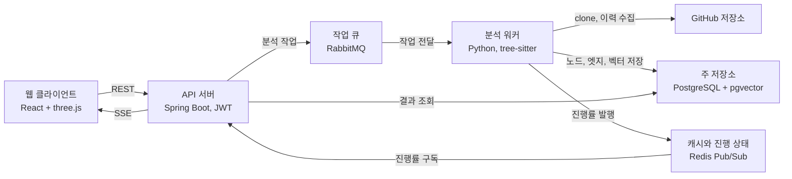

# 코드베이스 3D 지도 — 프로젝트 기획서

2026-11-02

## 프로젝트 개요

- GitHub 저장소를 넣으면 코드 간 관계를 구조(호출·import), 의미(코드 임베딩), 역사(같이 수정된 이력) 세 지도로 만들어 3D 공간에 겹쳐 보여주는 웹 서비스입니다.
- 핵심은 세 지도가 서로 어긋나는 지점, 즉 중복 구현, 숨은 결합, 책임이 섞인 모듈을 자동으로 찾아 탐색하게 하는 것입니다.
- 오픈소스 저장소에서 어긋남 상위 지점이 이후 버그 수정·리팩터링과 겹치는지 측정해, 시각화가 실제로 쓸모 있음을 수치로 증명합니다.

## 시스템 상세

분석은 수집, 세 지도 생성, 어긋남 탐지, 3D 렌더링, 검증의 다섯 단계로 전개됩니다. 아래 수치는 초기 설정값이며 실험으로 조정합니다.

1. **수집**: 저장소 URL을 받아 전체 이력과 함께 clone합니다. 분석 비용을 묶기 위해 기본 브랜치의 최근 커밋 2,000개까지만 봅니다.
2. **구조 지도**: tree-sitter로 파일을 파싱해 함수·클래스를 노드로, import와 호출을 엣지로 만듭니다. 초기 지원 언어는 Java와 Python 두 개로 제한합니다.
3. **의미 지도**: 함수 단위로 코드 임베딩을 만들어 벡터 저장소에 넣습니다. 코사인 유사도로 이웃을 구하고, UMAP으로 3차원 좌표를 뽑습니다.
4. **역사 지도**: git log에서 커밋마다 바뀐 파일 목록을 꺼내 함께 수정된 쌍의 빈도와 신뢰도를 계산합니다. 파일 50개 이상을 건드린 대량 커밋(포맷팅, 이름 일괄 변경)은 잡음이라 제외합니다.
5. **어긋남 탐지**: 같은 쌍에 대해 세 지도의 거리를 비교해 아래 세 유형으로 분류하고 점수를 매깁니다.
6. **3D 렌더링**: 노드 배치를 구조 모드(force 레이아웃)와 의미 모드(UMAP 좌표)로 전환할 수 있습니다. 엣지 색은 지도 종류를, 강조는 어긋남 점수를 뜻합니다. 커밋 타임랩스와 함수 하나를 바꿨을 때의 파급 애니메이션을 제공합니다.
7. **검증**: 과거 시점 T의 코드로 분석한 뒤, T 이후 버그 수정·리팩터링 커밋이 건드린 파일과 어긋남 상위 k개가 얼마나 겹치는지 측정합니다. 무작위로 고른 k개를 기준선으로 비교합니다.

| 어긋남 유형 | 구조 | 의미 | 함께 수정 | 의심되는 문제 |
| --- | --- | --- | --- | --- |
| 중복 구현 | 멂 | 가까움 | 상관없음 | 같은 로직이 두 곳에 있음 |
| 숨은 결합 | 멂 | 상관없음 | 잦음 | 코드에 드러나지 않은 의존 |
| 책임 혼재 | 연결됨 | 멂 | 상관없음 | 한 모듈이 성격이 다른 일을 함께 맡음 |

열린 질문: 버그 수정 커밋을 커밋 메시지 키워드(fix, bug)로 판별하면 오분류가 생깁니다. 이슈 트래커 연동 여부는 데이터 확보 상황을 보고 정합니다.

## 사용자 흐름

사용자는 저장소 하나를 넣고, 어긋남 목록에서 출발해 3D 공간과 코드 사이를 오가며 탐색합니다.

1. **저장소 입력**: GitHub URL을 붙여 넣습니다. 이미 분석된 저장소면 캐시된 결과를 바로 엽니다.
2. **분석 대기**: 진행률이 단계별(수집, 구조, 의미, 역사, 탐지)로 실시간 표시됩니다. 첫 결과가 나오기까지 수 분이 걸릴 수 있어, 끝나면 알림을 받고 나갔다 돌아올 수 있습니다.
3. **전체 지도 보기**: 3D 그래프가 열립니다. 레이어 토글로 구조, 의미, 역사 엣지를 켜고 끄며, 구조 모드와 의미 모드를 전환합니다.
4. **어긋남 목록 탐색**: 사이드 패널에 점수 순 어긋남 목록이 뜹니다. 항목을 누르면 카메라가 해당 쌍으로 날아가고 두 노드가 강조됩니다.
5. **코드 비교**: 강조된 두 함수의 소스를 나란히 보고, 왜 어긋남으로 잡혔는지(유사도, 함께 수정된 커밋 목록)를 확인합니다.
6. **파급·타임랩스**: 노드 하나를 골라 바꿨을 때 흔들리는 범위를 애니메이션으로 보거나, 커밋 타임랩스로 그 결합이 언제 생겼는지 되감아 봅니다.
7. **판단 기록**: 어긋남마다 "실제 문제" 또는 "오탐"으로 표시합니다. 이 표시는 검증 지표와 이후 점수 보정 데이터로 쓰입니다.
8. **공유**: 특정 시점과 카메라 위치를 담은 링크로 결과를 팀원에게 공유합니다.

## 기술 스택

API 서버는 Spring Boot, 분석은 Python 워커로 나누고, 둘을 메시지 큐로 잇는 구성입니다.

| 영역 | 기술 | 역할 |
| --- | --- | --- |
| 백엔드 API | Spring Boot (Java 21), Spring Security + JWT | 저장소 등록, 분석 작업 관리, 결과 조회, 공유 링크 |
| 분석 워커 | Python, tree-sitter, PyDriller, umap-learn | 파싱, git 이력 분석, 3D 좌표 계산, 어긋남 점수 계산 |
| 임베딩 | 오픈소스 코드 임베딩 모델(로컬 실행), 외부 임베딩 API는 비교용 | 함수 단위 벡터 생성 |
| 작업 큐 | RabbitMQ | API 서버와 분석 워커 사이의 작업 전달, 재시도 |
| 실시간 진행률 | Redis Pub/Sub + SSE | 단계별 진행률을 브라우저로 전송 |
| 프론트엔드 | React, TypeScript, react-three-fiber(three.js) | 3D 그래프, 레이어 토글, 카메라 이동, 타임랩스 |
| 코드 뷰어 | Monaco Editor | 어긋남 쌍의 소스 나란히 보기 |
| 주 저장소 | PostgreSQL + pgvector | 노드·엣지, 임베딩 벡터, 분석 결과, 판단 기록 |
| 캐시 | Redis | 분석 결과 캐시, 진행 상태 |
| 인프라 | Docker Compose, GitHub Actions, 클라우드 VM 1대 | 로컬·운영 동일 환경, 테스트와 배포 자동화 |

브라우저는 API 서버하고만 통신하고, 수 분짜리 분석은 큐를 거쳐 워커가 처리합니다. 진행률은 Redis를 통해 API 서버가 받아 SSE로 전달합니다.

## 기술 선택 이유

기준은 세 가지입니다. 문제에 맞는 도구인가, 이미 다뤄본 기술로 위험을 줄이는가, 부족한 경험(배포, CI/CD)을 채우는가입니다.

- **Spring Boot + Python 분리**: 파싱, 임베딩, UMAP 같은 분석 라이브러리는 Python 생태계가 압도적입니다. 반면 인증, 작업 관리, API는 이미 익숙한 Spring Boot가 빠릅니다. 언어를 하나로 통일하면 어느 한쪽이 불편해집니다.
- **tree-sitter**: 언어별 파서를 따로 쓰지 않고 같은 방식으로 여러 언어의 AST를 얻을 수 있어, 지원 언어를 늘릴 때 비용이 적습니다.
- **PyDriller**: 커밋별 변경 파일 추출을 직접 git 명령으로 파싱하는 것보다 안정적이고 코드가 짧습니다.
- **로컬 임베딩 모델 우선**: 저장소마다 함수 수천 개를 임베딩하므로 외부 API는 비용과 코드 유출 우려가 있습니다. 품질 차이는 외부 API와 비교 실험으로 확인합니다.
- **RabbitMQ**: 분석은 수 분짜리 장기 작업이라 요청과 처리를 분리해야 합니다. 작업 단위 전달과 재시도가 목적이라 Kafka의 로그 보존·재생 기능은 필요 없고, 이미 써보신 RabbitMQ가 더 단순합니다.
- **PostgreSQL + pgvector (Neo4j 미채택)**: 그래프 탐색은 파급 범위 계산(k단계 이웃) 정도라 재귀 쿼리로 충분합니다. 벡터까지 한 DB에 담으면 운영할 저장소가 하나 줄어듭니다. 탐색이 복잡해지면 그때 그래프 DB를 검토합니다.
- **Redis Pub/Sub + SSE**: 진행률은 서버에서 브라우저로 가는 단방향이라 WebSocket보다 SSE가 단순합니다.
- **react-three-fiber**: three.js를 React 컴포넌트로 다룰 수 있어 기존 React 경험을 살릴 수 있고, 카메라 이동·강조 같은 상태를 React 방식으로 관리할 수 있습니다. 노드가 수천 개를 넘으면 인스턴스 렌더링이 필요해, 성능 한계는 초기에 측정합니다.
- **Docker Compose + GitHub Actions**: 서비스가 5개(API, 워커, DB, Redis, RabbitMQ)라 한 번에 띄우는 도구가 필요합니다. 또한 아직 직접 해보지 못한 CI/CD와 배포를 이 프로젝트에서 처음부터 끝까지 경험하는 것이 포트폴리오 측면에서도 의미가 큽니다.
- **쿠버네티스 미채택**: VM 1대 규모에서는 학습·운영 비용 대비 이득이 없습니다.
